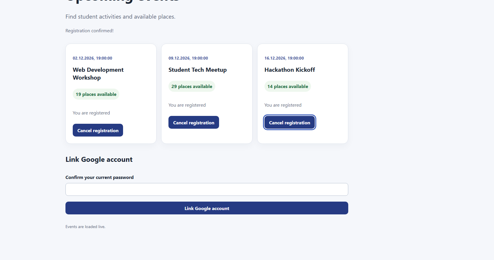

# UI checklist

<!-- Exercise 4 hands this in. Tick an item only when you have checked it, and replace
     the "how I checked" line with what you actually did. An unticked box is not a
     failure: it is a gap you then write into READINESS.md. A ticked box you cannot
     demonstrate at the defence is worse than an unticked one. -->

"Modern" is not a style. It is a short list of things a user notices when they are
missing: the screen tells you what is happening, you can get through it with a keyboard,
the text is readable, and nothing jumps around while it loads.

## Layout and typography

- [x] **One spacing scale and one type scale.** Sizes come from a small set of design tokens, not from numbers typed where they were needed.
  - how I checked: проверил в `public/styles.css` переменные `--space-*` и `--type-*` у форм, карточек и заголовков карточек.
- [ ] **Responsive at 380, 768 and 1280 pixels wide.** No horizontal scrollbar, no text running under another element.
  - how I checked: пользователь проверил список событий при ширине 380 CSS px. На снимке карточки выстроены в одну колонку. Проверки при 768 и 1280 px и остальные экраны ещё нужны. [Мобильный список](ui/mobile.png)
- [ ] **Nothing jumps while the page loads.** Images and cards reserve their space before their content arrives.
  - how I checked: сетка имеет минимальную высоту и сохраняет карточки при повторной загрузке. Запись Layout Shifts в DevTools ожидается.

## The four states, on every screen

A screen that only handles "it worked" is a screen that lies to the user on the day it matters.

- [ ] **Loading.** Something tells the user the app is working, within about 100 ms.
  - how I checked: при профиле 3G в Chrome DevTools видно «Loading events...» и ожидающие ответа запросы. В Node.js при задержанном ответе начальный текст загрузки уже был задан в HTML, а обработчики входа и записи выставляли статус до первого ожидания ответа. Также проверил статусы создания события и выхода. Время до отрисовки в браузере ещё нужно измерить. [Загрузка списка](ui/loading.png), [дополнительный кадр 3G](ui/success-3g.png)
- [x] **Empty.** The screen says what this list is for and what to do next, instead of showing nothing.
  - how I checked: в Chrome DevTools Local Overrides подставили для GET `/api/events` тело `{"events":[]}`. Карточки исчезли, появилось «There are no upcoming events. Check back later.». [Симуляция пустого списка](ui/empty.png)
- [x] **Error.** A sentence a person can read. Never a raw JSON body, never a stack trace, never just "Error".
  - how I checked: в Chrome DevTools заблокировали запрос списка. На странице появилось «Could not connect. Try again.». В Node.js подмена сетевого отказа дала то же сообщение, а повторная инициализация страницы без подмены снова загрузила карточки из SQLite. [Симуляция сетевой ошибки](ui/error.png)
- [x] **Success.** The user can see that what they did took effect, without reloading the page to find out.
  - how I checked: пользователь вручную проверил запись и отмену на Render. На снимке видны «Registration confirmed!», «You are registered» и кнопка отмены. [Подтверждение записи](ui/keyboard-focus.png)

## Keyboard and accessibility

- [ ] **The main flow works with the keyboard alone.** Sign in, do the core action, sign out, without touching the mouse.
  - how I checked: в Node.js вызвал обработчики входа, записи, отмены и выхода с реальными HTTP-маршрутами и SQLite в памяти. Проверил изменение карточки, возврат фокуса на кнопку карточки в имитации DOM и закрытие сессии. Нажатия клавиш и порядок обхода нужно проверить в браузере.
- [x] **The focused element is visible.** A `:focus-visible` outline that is not switched off.
  - how I checked: пользователь проверил клавиатурный фокус. На снимке виден контур кнопки «Cancel registration». Полный обход остальных экранов ещё нужен. [Фокус на кнопке](ui/keyboard-focus.png)
- [x] **Text contrast is at least 4.5:1.** Name the tool you measured with.
  - how I checked: рассчитал по формуле относительной яркости WCAG в Node.js для цветов основного текста, вторичного текста, меток, ссылок и кнопок. Минимум для проверенных пар 4,95:1.
- [ ] **Every input has a label** a screen reader reads, not just placeholder text.
  - how I checked: Python HTMLParser подтвердил непустые подписи всех восьми полей через `for` или вложение. Имена в дереве доступности и озвучивание ещё нужно проверить.
- [x] **The page has a correct `<title>` and `lang`.**
  - how I checked: в обоих HTML-файлах проверил `lang="en"` и разные названия страниц. Отдельная проверка HTTP-обработчика подтвердила title страницы входа.
- [ ] **Touch targets are at least 44 pixels.**
  - how I checked: проверил ограничения 44 × 44 CSS px в CSS для полей, кнопок, ссылки Google и нативных кнопок выбора файла и даты в Chromium. Фактические размеры и области нажатия нужно измерить в браузере.

## The model feature

- [x] **It shows that it is thinking.** A model call is slow and a free service may have been asleep; a frozen button is the worst possible answer.
  - how I checked: в Node.js задержал ответ на POST `/api/poster/suggest` и до его завершения проверил текст «Generating suggestions...» и отключённую кнопку.
- [x] **It shows when it failed,** and the rest of the screen still works.
  - how I checked: реальный локальный обработчик без ключа вернул отказ. Клиент показал «Automatic suggestions unavailable; enter event details manually.» и снова включил кнопку. Ввёл данные вручную, отправил форму и подтвердил появление события в списке и SQLite.
- [x] **The user can tell the model's suggestion from a fact.** It is labelled as a suggestion, not presented as data the app knows.
  - how I checked: подставил успешный ответ на запрос подсказки. Проверил заполнение названия, даты и места и текст «Review the suggestions before creating the event.». Число событий не изменилось до отдельной отправки формы. После изменения названия и заполнения вместимости проверил сохранение отредактированного события.

Автоматическая проверка модели запускала `public/app.js` в Node.js 22.23.4 с имитацией DOM и синтетическим PNG. Запросы входа, создания и чтения событий, а также отказ модели проходили через реальный HTTP-обработчик по потоку в памяти с одноразовой SQLite. Успешный ответ модели был подставлен локально. Запросов к Gemini и браузерных снимков этих сценариев не было.

Повторный локальный прогон подтвердил все три сценария модели, а также вход, запись, отмену, возврат фокуса в имитации DOM и выход. Статус выхода теперь находится перед списком событий. В ответе на запрос `/favicon.ico` без сессии проверены HTTP 200, MIME-тип и содержимое файла. Снимок waterfall отражает более раннюю версию.

## Decisions

- [x] **Dark mode, or a written decision not to have one.**
  - what I decided and why: Для Exercise 4 оставил одну светлую палитру, чтобы сократить объём проверок контраста.

## Evidence

| Снимок | Что видно |
| --- | --- |
| [Мобильный список](ui/mobile.png) | Карточки в одной колонке при ручной проверке на 380 CSS px. |
| [Фокус и успех](ui/keyboard-focus.png) | Контур кнопки отмены и сообщение о подтверждении записи. |
| [Загрузка](ui/loading.png) | «Loading events...» при замедлении 3G. |
| [Дополнительный кадр 3G](ui/success-3g.png) | На снимке с этим именем видны сообщение загрузки и незавершённые запросы. |
| [Сетевая ошибка](ui/error.png) | Сообщение о сбое при блокировке запроса в DevTools. |
| [Пустой список](ui/empty.png) | Сообщение об отсутствии событий при Local Overrides. |
| [Waterfall](ui/waterfall.png) | Семь запросов, в том числе `favicon.ico` со статусом 404. |

## Оставшиеся ручные проверки

В среде прогона браузер недоступен. Шесть пунктов ниже остаются открытыми до браузерной проверки.

1. **Адаптивность и размеры.** В Chrome откройте вход и список участника и организатора на 380, 768 и 1280 CSS px. Проверьте горизонтальную прокрутку, наложения и перенос длинного названия. Измерьте ширину и высоту элементов управления и ссылки Google, включая нативные кнопки выбора файла и даты, при ширине 380 px. Минимум — 44 CSS px.
2. **Загрузка и смещения.** С выключенным кэшем и замедленной сетью запишите Performance на входе и на страницах участника и организатора. Проверьте Layout Shifts и CLS при появлении данных. Измерьте показ статуса загрузки списка от первого кадра, а на формах и кнопках — от активации до появления статуса. Ориентир — около 100 мс.
3. **Клавиатура и доступные имена.** Через Tab, Shift+Tab, Enter и Space войдите, запишитесь, отмените запись и выйдите. Проверьте видимость фокуса, в том числе после смены кнопки карточки. На входе и у организатора проверьте объявление подписей полей в дереве доступности и экранным диктором.
